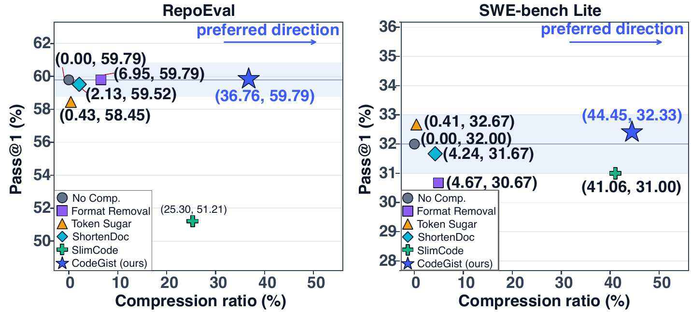

# CodeGist

This repository provides the code, scripts, schemas, and selected evaluation artifacts for CodeGist [**CodeGist: Schema-Guided Repository Context Compression for LLM Code Generation**]. This readme file includes:
- Directory structure
- Requirements
- Offline schema mining
- Online compression
- Evaluation helper scripts
- Results

## 🗂️ Directory structure
```text
CompressCode/
├── codegist/
│   ├── auto_mining/                     # Offline schema mining and online auto-compression modules
│   ├── lang/
│   │   ├── java/                        # Java tree-sitter frontend and renderer
│   │   └── typescript/                  # TypeScript tree-sitter frontend and renderer
│   ├── validators/                      # Token, structural, admissibility, and LLM validators
│   ├── compress.py                      # Descending-span rewrite application
│   └── selection.py                     # Token-optimal rewrite selection
├── results/                             # Selected RepoEval metrics, summaries, and logs
├── schemas/
│   ├── codegist_python_schemas.json
│   ├── codegist_python_schemas_no_apiidiom_209.json
│   ├── codegist_python_schemas_deepseek_curated_163.json
│   ├── codegist_java_schemas.json
│   └── codegist_typescript_schemas.json
├── scripts/
│   ├── mine_auto.py                     # Offline auto-mining entry script
│   ├── compress_auto.py                 # Online compression entry script
│   ├── eval_selection_baselines.py      # DP, greedy, and random selection ablation
│   ├── mine.py                          # Baseline mining CLI
│   ├── compress.py                      # Baseline compression CLI
│   ├── mine_resume.py                   # Rebuild schemas from a mining log
│   ├── retrieval_context.py             # Retrieved-context helpers for SWE-bench scripts
│   ├── run_repoeval_api_filebm25_sample.py
│   │                                    # RepoEval file-BM25 generation helper
│   ├── run_swebench_generation.py       # SWE-bench patch generation helper
│   └── run_swebench_two_stage_sketch.py # Two-stage SWE-bench generation helper
├── .env.example                         # Template for OpenAI-compatible LLM credentials
├── requirements.txt                     # Python package requirements
└── README.md                            # This README file
```

---

## ⚙️ Requirements
Run the following commands to create the local environment and install the required packages:
```bash
conda create -n CompressCode python=3.12.13
conda activate CompressCode
pip install -r requirements.txt
```

Java and TypeScript support use `tree-sitter`, `tree-sitter-java`, and `tree-sitter-typescript`, which are listed in `requirements.txt`.

Before running LLM-assisted mining or API-based evaluation scripts, create a `.env` file:
```bash
copy .env.example .env
```

The `.env` file should provide the following OpenAI-compatible API fields:
```text
LLM_MODEL_URL=
LLM_MODEL=
LLM_API_KEY=
```

Online compression with the shipped schema files does not call an LLM.

---

## ⛏️ Offline schema mining
This section gives example commands for mining schema JSON files from your own corpus directories.
The `out/` paths below are runtime output paths and are not included in this repository.

1. Mine Python schemas with LLM-synthesized write templates:
```bash
python -m scripts.mine_auto \
  --corpus path/to/python_corpus \
  --out out/schema_set_python.json \
  --llm-synth
```

2. Run a Python mining pass without LLM calls:
```bash
python -m scripts.mine_auto \
  --corpus path/to/python_corpus \
  --out out/schema_set_python_smoke.json \
  --skip-llm
```

3. Mine Java schemas:
```bash
python -m scripts.mine_auto \
  --lang java \
  --corpus path/to/java_corpus \
  --out out/schema_set_java.json \
  --llm-synth
```

4. Mine TypeScript schemas:
```bash
python -m scripts.mine_auto \
  --lang typescript \
  --corpus path/to/typescript_corpus \
  --out out/schema_set_typescript.json \
  --llm-synth
```

Common mining options:
```text
--use-recommended-excludes
--exclude PATTERN [PATTERN ...]
--llm-synth-budget N
--llm-synth-keep N
--llm-synth-concurrency N
--gain-threshold FLOAT
```

---

## 🗜️ Online compression
The online compression CLI reads the schema JSON header to choose the language. Schema files without a `language` field are treated as Python.
The `out/` paths below are runtime output paths for generated compressed files and reports.

1. Compress one Python file:
```bash
python -m scripts.compress_auto \
  --schemas schemas/codegist_python_schemas_no_apiidiom_209.json \
  --input path/to/python_file.py \
  --report
```

2. Compress a Python directory:
```bash
python -m scripts.compress_auto \
  --schemas schemas/codegist_python_schemas_no_apiidiom_209.json \
  --input-dir path/to/python_project \
  --out-dir out/compressed_python \
  --report
```

3. Compress one Java file:
```bash
python -m scripts.compress_auto \
  --schemas schemas/codegist_java_schemas.json \
  --input path/to/User.java \
  --report
```

4. Compress one TypeScript file:
```bash
python -m scripts.compress_auto \
  --schemas schemas/codegist_typescript_schemas.json \
  --input path/to/user.ts \
  --report
```

5. Run compression with alternative shipped Python schema sets:
```bash
python -m scripts.compress_auto \
  --schemas schemas/codegist_python_schemas.json \
  --input path/to/python_file.py \
  --report

python -m scripts.compress_auto \
  --schemas schemas/codegist_python_schemas_deepseek_curated_163.json \
  --input path/to/python_file.py \
  --report
```

---

## 🧪 Evaluation helper scripts
The `scripts/` directory also includes helper scripts for running generation tasks with external benchmark checkouts.

1. RepoEval file-BM25 generation:
```bash
python path/to/CompressCode/scripts/run_repoeval_api_filebm25_sample.py \
  --mode sketch \
  --codegist_root path/to/CompressCode \
  --data_file retrieval/results/repoeval-function-2k-bm25-filetop15-top5-sample60-10perrepo-with-metadata.jsonl \
  --output_path generation/results/codegist_filebm25_generations.json
```

Run this command from a CodeRAG-Bench checkout, because the script imports CodeRAG-Bench generation and RepoEval helpers.

2. SWE-bench generation helpers:
```bash
python path/to/CompressCode/scripts/run_swebench_generation.py

python path/to/CompressCode/scripts/run_swebench_two_stage_sketch.py
```

These scripts are intended to be launched from the benchmark workspace that provides the required SWE-bench data and retrieval outputs.

3. Selection-strategy ablation:
```bash
python -m scripts.eval_selection_baselines \
  --schemas schemas/codegist_python_schemas_no_apiidiom_209.json \
  --input-dir path/to/retrieved/python/files \
  --out-dir out/selection_baselines \
  --stats out/selection_baselines_stats.json
```

This script compares the DP selector with greedy and deterministic random non-overlap selection on the same generated rewrite candidates. By default, the random baseline reuses `--random-seed 42` for every file, matching the reported RepoEval selection-ablation setup.

---

## 📊 Results
The following figure summarizes the RQ1 comparison results.


